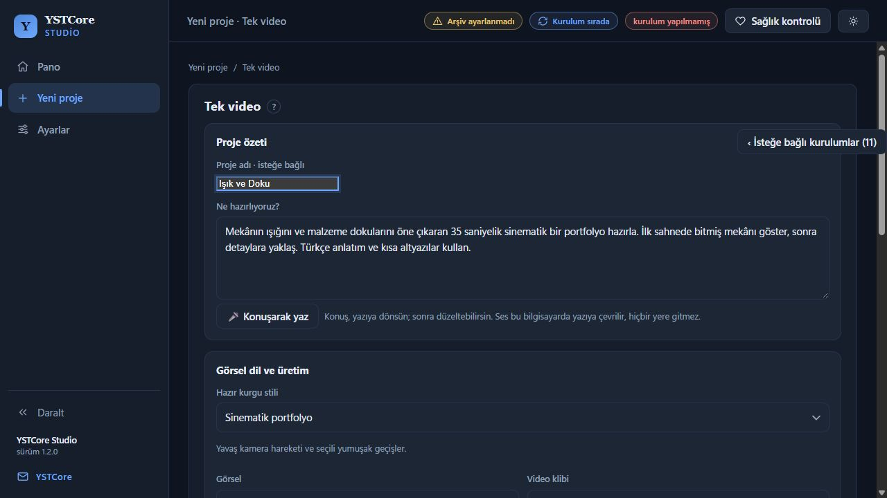
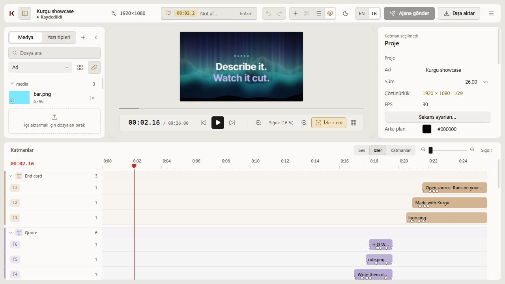

# YSTCore Studio

**Kendi arşivinden, Türkçe anlatımlı ve yayına hazır videolar üret.**

Fotoğraf, video, ses ve belgelerini ekle. Yapay zekâ orkestratörü isteğini bir sahne planına dönüştürür ve onayından sonra uzman ajanlara görev dağıtır. Kurgu zaman çizelgesinde taslağı izle, saniyesine not bırak ve hazır olduğunda YouTube, Reels, TikTok veya Shorts sürümlerini al. Arşiv, proje dosyaları ve render bilgisayarında yönetilir.

[](sistem/surum.json)
[](LICENSE)
[](#sistem-gereksinimleri)
[](#sistem-gereksinimleri)
[](#teknik-yapı)
[](.claude/skills/THIRD_PARTY_NOTICES.md#ffmpeg)

[](.claude/skills/THIRD_PARTY_NOTICES.md#remotion-eklentileri)
[](.claude/skills/THIRD_PARTY_NOTICES.md#heygen-hyperframes)
[](.claude/skills/THIRD_PARTY_NOTICES.md#kutuphaneler)
[](.claude/skills/THIRD_PARTY_NOTICES.md#kutuphaneler)
[](.claude/skills/THIRD_PARTY_NOTICES.md#leodavincs-kalem)
[](.claude/skills/THIRD_PARTY_NOTICES.md#leodavincs-kurgu)

[](.claude/skills/THIRD_PARTY_NOTICES.md#whisper-modelleri)
[](.claude/skills/THIRD_PARTY_NOTICES.md#ema-lightning)
[](.claude/skills/THIRD_PARTY_NOTICES.md#pocket-tts-turkish)
[](.claude/skills/THIRD_PARTY_NOTICES.md#orkestrator-baglantilari)

**[Sürümü indir](https://github.com/Mtemizce/YSTCoreStudio/releases)** · [Kurulum](#kurulum) · [İlk video](#ilk-videonu-hazırla) · [Modeller ve sağlayıcılar](#modeller-ve-sağlayıcılar) · [Bileşenler ve atıflar](#bileşenler-ve-atıflar)

### Stüdyoya göz at

| YSTCore Studio paneli | Kurgu editörü |
|:---:|:---:|
| <a href="docs/gorseller/studio-panel-canli.jpg"></a> | <a href="docs/gorseller/studio-kurgu-canli.jpg"></a> |
| Proje özeti, stil ve medya tercihleri | Kurgu’nun örnek projesinde sahne ve zaman çizelgesi |

Canlı uygulamalardan alınan görüntüleri büyütmek için üzerlerine tıkla.

## Bu stüdyoyla ne yapabilirsin?

| Elindeki malzeme | Alabileceğin çıktı |
|---|---|
| Şantiye fotoğrafları, DWG/SVG çizimleri, mekân videoları ve proje notları | Kalemle başlayan ara sahneler ve Türkçe anlatımla bir mimari proje tanıtımı. |
| Röportaj veya konuşma kaydı, B-roll ve müzik | Kelime zamanlı altyazı, onaylı sessizlik kesimleri ve vuruşlara göre kurgulanmış kısa klipler. |
| Ürün görselleri, ekran kayıtları veya bir sunum brief’i | Kinetik tipografi ve hareketli grafiklerle bir ürün tanıtımı, arayüz turu veya eğitim videosu. |
| Karakter, nesne ve mekân görselleri | Onaylı görselleri bölümler arasında yeniden kullanan bir video dizisi. |

Üretim sırasında panelde sahne planı, taslak, istenen revizyonlar ve teslim durumu izlenebilir. **Marka kiti** logoları, renkleri ve kullanım kurallarını projelere taşır. **Arşiv** ise disk, ağ klasörü veya bağlı bulut arşivindeki mevcut medyayı projeye eklemeyi sağlar.

## Kurulum

1. [GitHub Releases](https://github.com/Mtemizce/YSTCoreStudio/releases) sayfasından `YSTCoreStudio-<sürüm>.zip` dosyasını indir. Paket özetini aynı sürümdeki `.sha256` dosyasıyla karşılaştırabilirsin.
2. ZIP’i kalıcı bir klasöre çıkar. Windows’ta `C:\YST` gibi kısa bir klasör yolu kullanabilirsin.
3. İşletim sistemine uygun başlatıcıyı aç ve sihirbazı izle.

   | Sistem | Başlatıcı |
   |---|---|
   | Windows 10/11 x64 | `Başlat.cmd` |
   | Linux | `bash baslat.sh` |
   | macOS | `Başlat.command` |

4. Panel açılınca **Ayarlar → Yapay zekâ** bölümünde [orkestratörü seç](#modeller-ve-sağlayıcılar). Ardından **Yeni proje** üzerinden tek video veya dizi başlat.

Windows sihirbazı eksik Python, Node.js ve Git için otomatik kurulum başlatabilir. İlk açılıştan sonra temel modeller arka planda hazırlanır. İndirme ilerlemesini ve varsa hataları panelden görebilirsin.

Geliştirme için kaynak kodu klonlayıp aynı başlatıcıyı kullanabilirsin.

```bash
git clone https://github.com/Mtemizce/YSTCoreStudio.git
cd YSTCoreStudio
```

### Sistem gereksinimleri

| Bileşen | Temel kurulum |
|---|---|
| Python, Node.js, Git | Python 3.10+, Node.js 20+ ve Git. Python 3.12 önerilir. |
| Bellek ve disk | 8 GB RAM ve CPU kurulumu için yaklaşık 8 GB boş disk. Projeler, önbellek ve isteğe bağlı modeller ek alan kullanır. |
| Ekran kartı | Temel panel ve render için ayrık GPU gerekmez. Yerel üretim modellerinin donanım koşulları aşağıda ayrı verilmiştir. |
| İnternet | İlk kurulum, model indirmeleri, güncellemeler ve seçtiğin uzak sağlayıcılar için gerekir. |
| DWG | DWG dönüştürme Windows’ta desteklenir. |

| Ne zaman? | Neler hazırlanır? |
|---|---|
| İlk kurulum | Python ortamı, Kurgu editörü, Remotion ve HyperFrames araçları. FFmpeg sistemde yoksa kurulum sağlanan ikiliyi kullanır. |
| Panel açıkken | Yerel konuşma tanıma, Türkçe seslendirme, fotoğraf iyileştirme ve derinlik haritası bileşenleri. |
| İsteğe bağlı | Z-Image, Wan, ACE-Step, daha büyük Whisper modelleri, GPU hızlandırma ve müzik/efekt arşivi. Boyut ve kurulum durumu panelde bileşene göre gösterilir. |

## İlk videonu hazırla

1. **Yeni proje → Tek video** ekranına gir. Kaynakları yükle veya arşivden seç. İstemi yaz, hedef platformu, varsa marka kitini ve kurgu stilini belirle. Hazır stili menüden seçebilir ya da istemde adıyla isteyebilirsin.
2. **Hikâye tahtasını incele.** Orkestratör anlatımı ve sahnelerin akışını önerir. Varsa sessizlik kesimleri de panelde görünür. Onayla veya değişiklik iste. Plan değişirse yeniden onay gerekir.
3. **Taslağı Kurgu’da izle.** Uzman ajanlar onaylı planı sahnelere, ses ve altyazıya dönüştürür. Zaman çizelgesindeki bir kareye veya saniyeye not bırakıp **Gönder** ile revizyon iste.
4. **Teslim al.** Taslağı onayla. Stüdyo final çıktıyı ve seçtiğin platform sürümlerini oluşturur.

Şu istemle arşivindeki bir projeyi deneyebilirsin.

> Yüklediğim salon fotoğrafları ve proje notlarından 35 saniyelik dikey bir mimari tanıtım hazırla. İlk iki saniyede bitmiş mekânı göster. Ardından önce ve sonra görüntülerini karşılaştır. Sade Türkçe anlatım ve kelime zamanlı altyazı kullan. Finalden önce hikâye tahtasını incelemek istiyorum.

### Örnek çıktı

Kalemle çizilen portre ve bayrak gerçek görüntüye dönüşüyor. Örnek, projeye yüklenen portre, SVG bayrak, metin ve arşiv ses kaydıyla üretildi. Sesli tam sürüm ve altyazı [Releases](https://github.com/Mtemizce/YSTCoreStudio/releases) sayfasında. Girdiler ve kaynak hakları [örnek video atıflarında](docs/ornek/ATIF.md).

[](docs/gorseller/ornek-ataturk.gif)

*Hareketli önizlemeyi açmak için görsele tıkla.*

## Modeller ve sağlayıcılar

### Orkestratör

Orkestratör brief’i okur, sahne planını kurar ve görevleri dağıtır. **Ayarlar → Yapay zekâ** bölümünden çalışma ortamı ve model seçilir.

| Çalışma ortamı | Başlamak için |
|---|---|
| Claude Code | Claude Code kurulumu ve mevcut sağlayıcı oturumu. Klasör güveni ve araç onayları panelden yönetilir. |
| Ollama, LM Studio veya llama.cpp | Çalışan yerel sunucu ve araç çağırmayı destekleyen bir model. Panelde adresi kaydet, model listesini yenile ve modeli seç. |
| Codex CLI, Gemini CLI veya OpenCode | Deneysel adaptörler. Oturum ve yetenekler seçilen istemciye bağlıdır. |

### Görsel, video, müzik ve ses

Medya tercihleri **proje bazında** seçilir. Arşivdeki kaynakları kullanabilir, sahneyi Kurgu ajanına bırakabilir, isteğe bağlı yerel bir model kurabilir veya bir API bağlayabilirsin.

| İş | Yerel seçenek | Kullanım notu |
|---|---|---|
| Görsel üretim | [Z-Image-Turbo](.claude/skills/THIRD_PARTY_NOTICES.md#z-image-modelleri) | Metinden görsel üretir. Onaylı çıktılar görsel kütüphanesinde başka projelere de eklenebilir. |
| Video üretim | [Wan 2.2 TI2V-5B](.claude/skills/THIRD_PARTY_NOTICES.md#wan-modeli) | Hazır paket Windows x64, CUDA 12.8 uyumlu NVIDIA sürücüsü ve en az 4 GB VRAM ister. Yaklaşık 12 GB disk ve 8 GB boş RAM ayır. |
| Müzik üretimi | [ACE-Step 1.5 Turbo](.claude/skills/THIRD_PARTY_NOTICES.md#ace-step) | Bu entegrasyon sözsüz fon müziği üretir. |
| Türkçe seslendirme | [EMA Lightning](.claude/skills/THIRD_PARTY_NOTICES.md#ema-lightning) · [Pocket TTS Turkish](.claude/skills/THIRD_PARTY_NOTICES.md#pocket-tts-turkish) | Türkçe anlatım, hazır sesler ve Pocket TTS ile izinli ses klonlama. |
| Dikte ve altyazı | [faster-whisper](.claude/skills/THIRD_PARTY_NOTICES.md#whisper-modelleri) | Dikte, konuşma transkripti ve altyazı zamanlama. Varsayılan model `small`. |

İsteğe bağlı modelleri paneldeki **İsteğe bağlı kurulumlar** bölümünden kur. Proje sohbetinde `/görsel`, `/video` ve `/müzik` komutları dil modelini çağırmadan projenin seçili sağlayıcısını kullanır. Bulut seçeneğinde servis kotası, ücret ve proje izni geçerlidir. Gemini, OpenAI görsel, ElevenLabs ve fal / Seedance örnekleri için [bağlayıcı tablosuna](.claude/skills/THIRD_PARTY_NOTICES.md#medya-baglayicilari) bak.

## Arşiv, gizlilik ve bakım

- **Arşiv ve proje dosyaları.** Arşiv dizini dosya ve klasör adlarında arama yapar. Seçilen medya projeye kopyalanır. Orijinal arşiv dosyaları yerinde kalır. Proje ayarları ve çıktılar `projeler/` altında saklanır.
- **Yerel ve uzak işlemler.** Panel yerel makinede çalışır. Dikte, render ve yerel modellerin işlenmesi bilgisayarda gerçekleşir. Bulut orkestratörü kullanırsan modele gönderilen istem, metin ve incelenen kareler sağlayıcıya iletilir. Uzak arşiv veya medya API’si işlemleri seçtiğin hizmetin bağlantısını kullanır.
- **Taslak ve iptal.** Üretimi durdurup brief ve kaynakları taslak olarak koruyabilirsin. Panel, devam eden işi ve senden onay bekleyen aşamayı gösterir.
- **Güncelleme ve onarım.** **Ayarlar → Sistem ve güncelleme** bölümünde sürümü kontrol et. Kurulum sen başlattığında çalışır. İndirme yarım kaldıysa, bir bileşen görünmüyorsa veya editör açılmıyorsa önce **Sağlık kontrolü** sonucuna bak.

Arşivi başka bilgisayara taşıma, yedekleme ve marka kiti ayarlarının adımları [kullanım kılavuzunda](docs/KULLANIM.md) yer alıyor.

## Teknik yapı

| Konum | İçerik |
|---|---|
| [`sistem/panel/`](sistem/panel) | Yerel Python HTTP sunucusu ve tarayıcı arayüzü. |
| [`sistem/araclar/`](sistem/araclar) ve [`sistem/arsiv/`](sistem/arsiv) | Orkestrasyon, medya araçları ve SQLite arşiv dizini. |
| [`sistem/kit/`](sistem/kit) | Remotion, HyperFrames ve kalem animasyonu için üretim bileşenleri. |
| [`.claude/`](.claude) | Uzman ajanlar, iş akışları ve skill belgeleri. |
| [`sistem/yama/kurgu/`](sistem/yama/kurgu) | Kurgu editörüne stüdyo özelliklerini ekleyen yerel yama. |

JavaScript bağımlılıkları [package.json](package.json), Python paketleri [gereksinim dosyaları](sistem/kurulum) ve dış kaynak revizyonları [kurulum manifesti](sistem/kurulum/dis_kaynaklar.json) üzerinden izlenir. Geliştirme testlerini `python sistem/testler/calistir.py` komutuyla çalıştırabilirsin. GitHub Actions test matrisi Windows, Linux ve macOS’u kapsar. [İş akışı](.github/workflows/test.yml)

## Bileşenler ve atıflar

Her bağlantı [THIRD_PARTY_NOTICES.md](.claude/skills/THIRD_PARTY_NOTICES.md) içindeki ilgili açıklamaya gider. Orada kaynak, sürüm veya revizyon, lisans ve yerel uyarlama bilgisi yer alır.

### Teşekkürler

Dosyalarını, skill’lerini, modellerini, eklentilerini ve üretim tekniklerini paylaşan tüm geliştiricilere, ekiplere ve katkıcılara teşekkür ederiz.

| Katkı alanı | Kaynak sahipleri ve ekipler |
|---|---|
| Skill’ler, editörler ve animasyon | Anthropic, artificialguybr, Avenox, echris6, GL Transitions, GreenSock, HeyGen, leodavincs, LottieFiles, Paper.js, React ve Remotion |
| Modeller ve çalışma araçları | ACE-Step, alexturkey, Black Forest Labs, canberkkkkkk, city96, Comfy-Org, Depth Anything, FFmpeg, Kyutai, leejet, LibreDWG, Mobius Labs, OpenAI Whisper, PyTorch, QuantStack, Qwen, rclone, SYSTRAN, Tongyi-MAI, Unsloth, Wan-AI, wite-tech ve xinntao |
| Tasarım ve montaj referansları | haidrrrry, howseen-ai, latent-spaces, Nate Herk, owlinthebarnai, shadcn-labs, tugrawork-creator ve tuzhechen2005 |
| Müzik, efektler ve yazı tipleri | Musopen, Pixabay ve Wikimedia Commons katkıcıları, Wyzowl ve kullanılan yazı tiplerinin tasarımcıları |

### Skill’ler

| Skill | Kullanım |
|---|---|
| [`video-yonetmen`, `kisilik-ve-ton`, `kurgu-video-studio`](.claude/skills/THIRD_PARTY_NOTICES.md#yerlesik-skiller) | Proje yönetimi, üslup ve sahne üretimi için stüdyonun kendi rehberleri. |
| [`kaba-kurgu`](.claude/skills/THIRD_PARTY_NOTICES.md#avenox-roughcut) | `avenoxai/avenoxskills` içindeki `avenox-roughcut` rehberinden uyarlanan kaba kurgu ve sessizlik kesimi. |
| [`marka-kilidi`](.claude/skills/THIRD_PARTY_NOTICES.md#avenox-graphics) | `avenox-graphics` içindeki marka çerçevesinden uyarlanan görsel tutarlılık kuralları. |
| [`hook-ve-kapak`](.claude/skills/THIRD_PARTY_NOTICES.md#avenox-thumbnail) | `avenox-thumbnail` içindeki açılış ve kapak fikirlerinden uyarlanan rehber. |
| [`sosyal-surumler`](.claude/skills/THIRD_PARTY_NOTICES.md#avenox-video) | `avenox-video` yönlendiricisinden esinlenen platforma özel teslim akışı. |
| [`kalem-cizim`, `referans`](.claude/skills/THIRD_PARTY_NOTICES.md#leodavincs-kalem) | Çizim ara sahnesi ve referans videonun sahne analizi. |
| [`kurgu`](.claude/skills/THIRD_PARTY_NOTICES.md#leodavincs-kurgu) | Kurgu editörü ve üretim akışı. |
| [`remotion-best-practices`](.claude/skills/THIRD_PARTY_NOTICES.md#remotion-dev-skills) | React tabanlı sahne, altyazı ve render. |
| [`hyperframes`, `hyperframes-cli`](.claude/skills/THIRD_PARTY_NOTICES.md#heygen-hyperframes) | HTML tabanlı sahne ve komut satırı araçları. |
| [`business-motion-film`](.claude/skills/THIRD_PARTY_NOTICES.md#echris6-motion-video-kit) | Hareketli grafikler ve çıktı denetimi. |
| [`hyperframes-video-director`](.claude/skills/THIRD_PARTY_NOTICES.md#artificialguybr-hyperframes-video-director) | Sahne yönetimi ve değerlendirme ölçütleri. |
| [`frontend-design`](.claude/skills/THIRD_PARTY_NOTICES.md#anthropics-skills) | Görsel tasarım ilkeleri. |
| [`gsap-core`, `gsap-timeline`, `gsap-plugins`, `gsap-performance`, `gsap-utils`](.claude/skills/THIRD_PARTY_NOTICES.md#greensock-gsap-skills) | Animasyon, zamanlama, eklenti kullanımı ve performans. |
| [`gl-transitions`](.claude/skills/THIRD_PARTY_NOTICES.md#gl-transitions) | Shader tabanlı geçişler. |
| [`motion-design`](.claude/skills/THIRD_PARTY_NOTICES.md#lottiefiles-motion-design) | LottieFiles hareket tasarımı rehberi. |

### Modeller, eklentiler ve araçlar

| Bileşen | Kullanım |
|---|---|
| [EMA Lightning](.claude/skills/THIRD_PARTY_NOTICES.md#ema-lightning) · [Pocket TTS Turkish](.claude/skills/THIRD_PARTY_NOTICES.md#pocket-tts-turkish) | Türkçe seslendirme, hazır sesler ve ses klonlama. |
| [Whisper: tiny, base, small, medium, large-v3-turbo ve large-v3](.claude/skills/THIRD_PARTY_NOTICES.md#whisper-modelleri) | Dikte, transkript ve altyazı zamanlama. |
| [Real-ESRGAN x4plus](.claude/skills/THIRD_PARTY_NOTICES.md#real-esrgan) · [Depth Anything V2 Small](.claude/skills/THIRD_PARTY_NOTICES.md#depth-anything) | Fotoğraf iyileştirme ve derinlik haritası. |
| [Z-Image-Turbo ve GGUF](.claude/skills/THIRD_PARTY_NOTICES.md#z-image-modelleri) · [Qwen3 metin kodlayıcısı](.claude/skills/THIRD_PARTY_NOTICES.md#z-image-qwen) · [FLUX VAE](.claude/skills/THIRD_PARTY_NOTICES.md#z-image-vae) | İsteğe bağlı yerel görsel üretimi. |
| [Wan 2.2 TI2V-5B ve VAE](.claude/skills/THIRD_PARTY_NOTICES.md#wan-modeli) · [UMT5 XXL](.claude/skills/THIRD_PARTY_NOTICES.md#wan-umt5) | İsteğe bağlı yerel video üretimi. |
| [ACE-Step 1.5 Turbo](.claude/skills/THIRD_PARTY_NOTICES.md#ace-step) | İsteğe bağlı yerel enstrümantal müzik üretimi. |
| [Kurgu editörü ve yerel yama](.claude/skills/THIRD_PARTY_NOTICES.md#leodavincs-kurgu) | Zaman çizelgesi, proje aktarımı ve Türkçe konuşma entegrasyonu. |
| [Remotion ve sahne eklentileri](.claude/skills/THIRD_PARTY_NOTICES.md#remotion-eklentileri) · [HyperFrames](.claude/skills/THIRD_PARTY_NOTICES.md#heygen-hyperframes) · [GL Transitions](.claude/skills/THIRD_PARTY_NOTICES.md#gl-transitions) | Video sahneleri, animasyon ve geçişler. |
| [React, GSAP, Paper.js, PyTorch ve diğer kütüphaneler](.claude/skills/THIRD_PARTY_NOTICES.md#kutuphaneler) | Sahne çizimi, animasyon ve yerel işleme. |
| [stable-diffusion.cpp](.claude/skills/THIRD_PARTY_NOTICES.md#stable-diffusion-cpp) · [Z-Image Pascal tarifi](.claude/skills/THIRD_PARTY_NOTICES.md#z-image-pascal) · [Wan Pascal paketi ve çalışma zamanları](.claude/skills/THIRD_PARTY_NOTICES.md#yerel-video-uretim) | Yerel görsel ve video modellerinin çalıştırılması. |
| [Claude Agent SDK ve orkestratör bağlantıları](.claude/skills/THIRD_PARTY_NOTICES.md#orkestrator-baglantilari) · [Medya API bağlayıcıları](.claude/skills/THIRD_PARTY_NOTICES.md#medya-baglayicilari) | Yerel veya bulut orkestratörü ve isteğe bağlı servis entegrasyonları. |
| [FFmpeg](.claude/skills/THIRD_PARTY_NOTICES.md#ffmpeg) · [LibreDWG ve rclone](.claude/skills/THIRD_PARTY_NOTICES.md#araclar) | Kodlama, DWG dönüştürme ve bulut arşivine erişim. |
| [Müzik ve ses efektleri](.claude/skills/THIRD_PARTY_NOTICES.md#muzik-ve-ses-efektleri) · [Yazı tipleri](.claude/skills/THIRD_PARTY_NOTICES.md#yazi-tipleri) | Projelerde kullanılabilen hazır varlıklar. |

### Tasarım ve montaj referansları

Bu kaynaklardan yararlanılan teknikler atıf dosyasında açıklanır.

| Kaynak | Referans alınan konu |
|---|---|
| [Video Studio Kit](.claude/skills/THIRD_PARTY_NOTICES.md#video-studio-kit) | Stil ve araç kataloğu. |
| [Claude Remotion Skill](.claude/skills/THIRD_PARTY_NOTICES.md#haidrrrry-claude-remotion-skill) | Remotion sahne tasarımına ilişkin uygulama notları. |
| [Opus Video Skills](.claude/skills/THIRD_PARTY_NOTICES.md#opus-video-skills) | Kinetik tipografi. |
| [Brag](.claude/skills/THIRD_PARTY_NOTICES.md#brag) | Render’ın ilk karesini denetleme. |
| [Claude Motion Design](.claude/skills/THIRD_PARTY_NOTICES.md#claude-motion-design) | Müzikten vuruş adayları çıkarma. |
| [Herk Edit Kit](.claude/skills/THIRD_PARTY_NOTICES.md#herk-edit-kit) | Kelime zamanları ve kesim doğrulama. |
| [SaaS Motion Kit](.claude/skills/THIRD_PARTY_NOTICES.md#saas-motion-kit) | Tanıtım sahneleri ve hareket düzenleri. |
| [Snapcn](.claude/skills/THIRD_PARTY_NOTICES.md#snapcn) | Modüler düzen ve hareket stilleri. |

YSTCoreStudio’nun kendi kodu [MIT lisanslıdır](LICENSE). Kullanılan bileşenlerin kendi koşulları geçerlidir. Özellikle [Remotion koşullarını](.claude/skills/THIRD_PARTY_NOTICES.md#remotion-dev-skills) ve [Pocket TTS Turkish atıf bilgilerini](.claude/skills/THIRD_PARTY_NOTICES.md#pocket-tts-turkish) incele.

## Katkı ve destek

Hata ve önerileri [Issues](https://github.com/Mtemizce/YSTCoreStudio/issues) üzerinden iletebilirsin. Geliştirme için [katkı kılavuzuna](CONTRIBUTING.md), güvenlik bildirimi için [bildirim politikasına](SECURITY.md) bak.

## Katkıda bulunanlar

<!-- katkicilar:basla -->
Henüz kimse yok: ilk katkıyı sen yap! ([CONTRIBUTING.md](CONTRIBUTING.md))
<!-- katkicilar:bitis -->

## Sponsorlar

<!-- sponsorlar:basla -->
Henüz sponsor yok. Sponsor olursan profil resmin burada görünür ([GitHub Sponsors](https://github.com/sponsors/Mtemizce)).
<!-- sponsorlar:bitis -->
