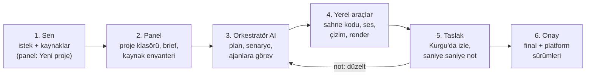
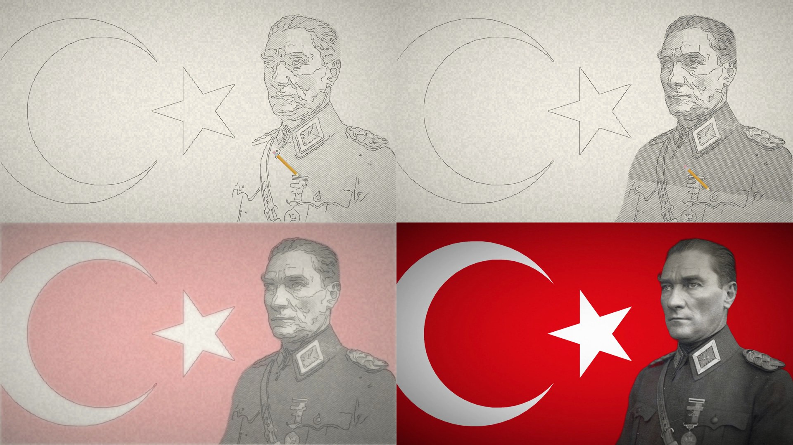
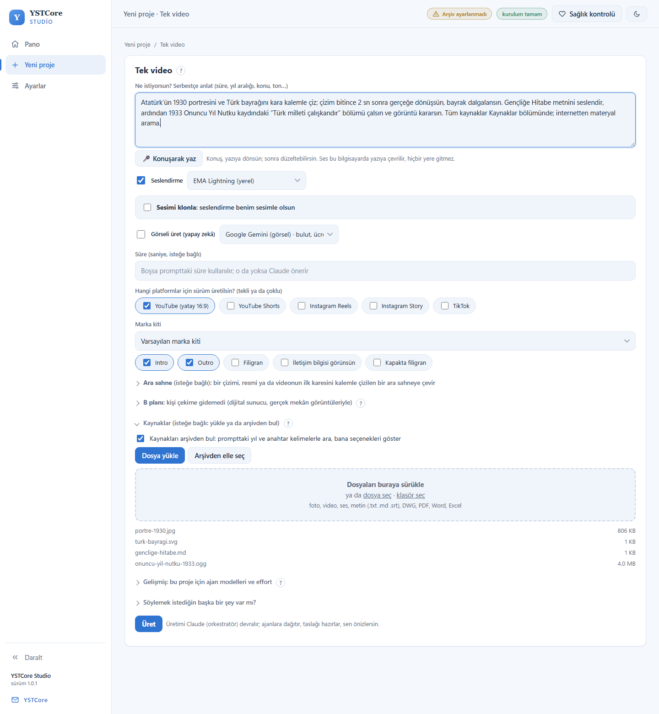
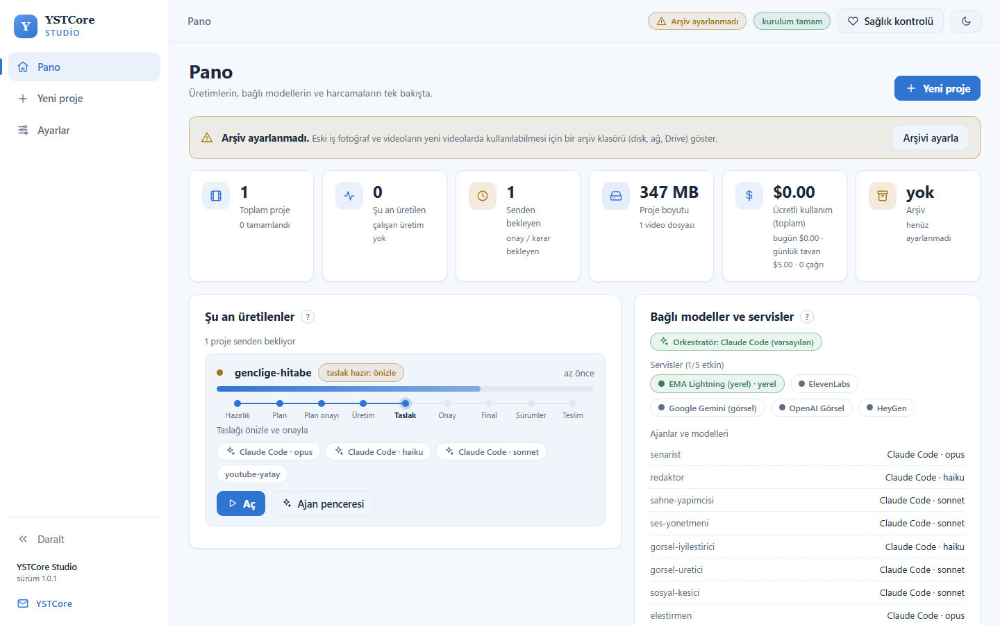
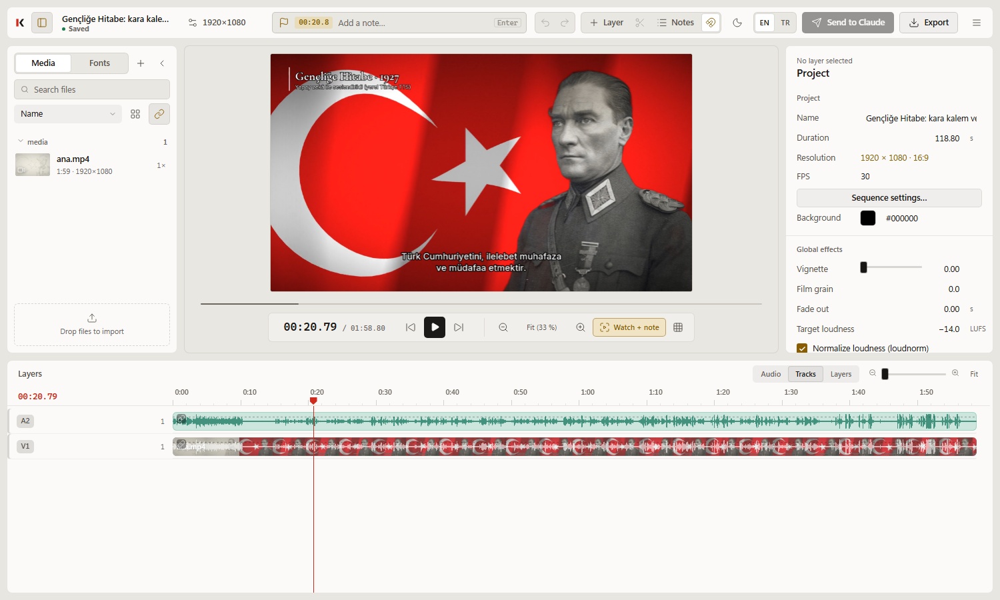
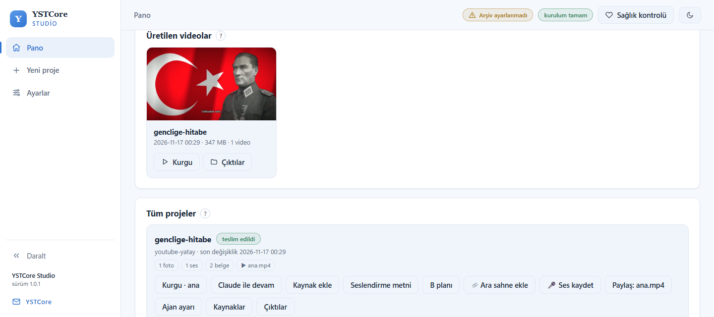
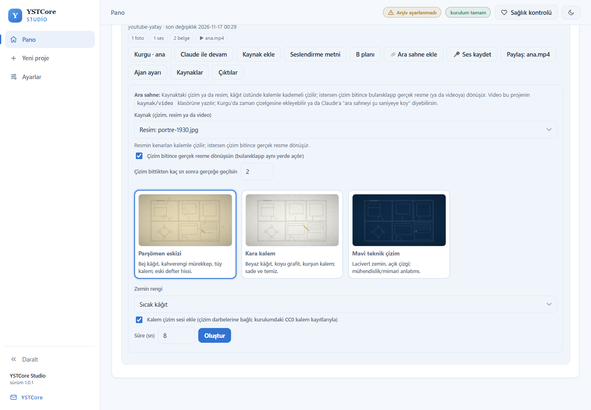

# YSTCoreStudio

**Bilgisayarında çalışan, Türkçe odaklı video stüdyosu: bir yapay zekâ ajanının (orkestratör) kullandığı araç takımı.** Sen isteği ve kaynakları verirsin; orkestratör planlar, bu araçlarla yerelde üretir. Stüdyonun kendisinde hesap ve telemetri yoktur; araçlar ve panel `127.0.0.1`'de, senin makinende çalışır.

## Nedir?

YSTCoreStudio, fotoğraf, video, DWG, PDF, Word ve Excel dosyalarını verip serbestçe "şunu anlatan 40 saniyelik bir video yap" dediğin bir **video post-prodüksiyon stüdyosudur**. Tarayıcıda açılan bir panelden proje başlatırsın; Claude Code orkestratörü senarist, redaktör, ses yönetmeni ve eleştirmen gibi uzman ajanlara iş dağıtır. Seslendirme (kendi sesini klonlayarak bile), altyazı, müzik, geçişler, fotoğraf iyileştirme ve kalemle çizilen ara sahneler yerelde üretilir; sonucu [Kurgu](https://github.com/leodavincs/kurgu) zaman çizelgesinde izler, saniye saniye not yazar, beğenince YouTube, Reels, TikTok ve Shorts sürümlerini alırsın. Ücretli bulut servisleri (ElevenLabs, Gemini, OpenAI görsel) **isteğe bağlıdır ve varsayılan kapalıdır**.

> **Önemli: bu depo tek başına video üretmez.** Stüdyo; render, ses, çizim, arşiv ve editör araçlarını ve ajanlara talimatlarını (`.claude/`) bir araya getirir, **işi yöneten bir yapay zekâ ajanı (orkestratör) gerekir**. Varsayılan ve en iyi desteklenen orkestratör **Claude Code'dur ve bir Claude aboneliği ister**. Codex CLI, Gemini CLI ve OpenCode da seçilebilir (deneysel; her biri kendi aboneliğiyle). Abonelik istemiyorsan OpenCode'u yerel bir model sunucusuna (Ollama, LM Studio) bağlayabilirsin; bu yol da deneysel: yerel modellerin bu çok adımlı iş akışını ne kadar iyi yürüteceği modele ve donanımına bağlıdır.

## Nasıl çalışır?

**Kısaca:** sen *isteği ve kaynaklarını* verirsin; orkestratör *planlar ve işleri dağıtır*; üretimi *senin bilgisayarındaki araçlar* yapar. Orkestratör internette materyal arayıp getirmez.

| Aşama (panelde adım) | Kim yapar | Ne olur |
|---|---|---|
| **Hazırlık** | Panel (yerel) | Proje klasörü açılır; isteğin `brief.md` ve `uretim.json` olur; yüklediğin dosyalar `kaynak/` altına konur, envanteri çıkarılır (DWG/PDF/Word/Excel dönüşümleri dahil) |
| **Plan** | Orkestratör AI | Brief, kimlik dosyaların ve kaynaklar okunur; senaryo ve hikâye tahtası yazılır, redaktör denetler |
| **Plan onayı** | Sen | İstersen planı onaylarsın |
| **Üretim** | Orkestratör + yerel araçlar | Ajanlar sahne kodunu (Remotion/HyperFrames), seslendirmeyi, müzik/ses efektini, kalemle çizimi, fotoğraf iyileştirmeyi **bu bilgisayarda** üretir; her teslimi orkestratör kareye ve ölçüme bakarak doğrular |
| **Taslak** | Sen | Kurgu editöründe izler, saniye saniye not yazarsın; notlar uygulanır |
| **Onay → Final → Sürümler → Teslim** | Orkestratör + yerel araçlar | Final render ve seçtiğin platformların (YouTube, Reels, TikTok, Shorts) sürümleri çıkar |

Bu adımlar panelde her projenin kartında bir **süreç zaman çizelgesi** olarak (Hazırlık → Plan → Plan onayı → Üretim → Taslak → Onay → Final → Sürümler → Teslim) görünür; "Pano → Şu an üretilenler".

### Materyal nereden gelir? (internet var mı?)

Stüdyo **üretim sırasında internetten foto, video, ses, müzik ya da başka materyal aramaz ve indirmez**. Girdiler yalnızca şunlardır:

1. **Senin verdiğin kaynaklar:** panelde *Yeni proje → Kaynaklar* ile yüklediğin foto, video, ses, metin, DWG/PDF/Word/Excel.
2. **Senin arşivin:** yerel/harici disk, ağ ya da Drive/OneDrive/Dropbox klasörün (salt okunur), **Resim, Video, Müzik ve Dosya** kategorileriyle. "Arşivden bul" yıl, konu ve aşamaya göre seçer; müzik klasörünü ayrı bir arşiv olarak ekleyip isteğinde müziğin **adını** yazman yeter (örn. *arka planda "Tarkan - Şımarık" çalsın*), orkestratör arşivinde bulup kullanır.
3. **Stüdyonun yerelde ürettikleri:** kodla çizilen sahneler, yerel Türkçe seslendirme (EMA Lightning, Pocket TTS Turkish), kalemle çizim, Real-ESRGAN ile fotoğraf iyileştirme ve isteğe bağlı olarak panelden indirilen CC0 müzik ve ses efektleri.
4. **İsteğe bağlı, varsayılan kapalı:** ücretli bulut servisleri (ElevenLabs, Gemini, OpenAI görsel). Ayarlardan açıp projede ayrıca izin vermedikçe hiç çağrılmaz.

**Kaynak vermezsen** orkestratör sana sorar ya da yalnızca kodla/yerel araçlarla üretir; "internetten bulurum" demez. Bu kural ajan talimatlarında (`.claude/CLAUDE.md`) yazılıdır ve Claude Code'da `WebSearch`/`WebFetch` araçları bu klasörde engellidir (`.claude/settings.json`). Bunu bir ağ güvenlik duvarı sanma: ajan kod çalıştırabildiği için kesin garanti istiyorsan stüdyoyu çevrimdışı çalıştır. Kurulum sırasında (paket ve model indirme) ve güncellemede internet gerekir.

### Neler dışarı çıkar?

- **Orkestratör bulutta çalışan bir yapay zekâysa** (Claude, Codex, Gemini): yazdığın istek, brief, senaryo, ajan çıktıları ve ajanın okuduğu metinler ile baktığı kare görüntüleri **o sağlayıcıya gider** (sağlayıcının kendi gizlilik koşulları geçerlidir). Stüdyo kaynak medya dosyalarını kendiliğinden buluta yüklemez; ama bir ajan bir kareye ya da fotoğrafa "bakarsa" o görüntü modele gönderilmiş olur.
- **Hiçbir zaman dışarı çıkmayanlar:** dikte (konuşarak yazma, yerel faster-whisper), seslendirme, ses klonlama ve örnek sesin kendisi, render, fotoğraf iyileştirme, kalemle çizim, arşiv veritabanı.
- Bunu istemiyorsan orkestratörü yerel bir modele bağla (yukarıdaki deneysel yol).

### Örnek akış

Bu belgenin [örnek videosu](#örnek-kara-kalemle-çizilen-portre-gerçeğe-dönüşen-bayrak) tam olarak bu şekilde yapıldı: portre, bayrak SVG'si, hitabe metni ve 1933 ses kaydı panelde **Kaynaklar'a yüklendi**, istek yazıldı; orkestratör kaynaklardan videoyu üretti (aşağıdaki ekran görüntüleri).

## Örnek: kara kalemle çizilen portre, gerçeğe dönüşen bayrak

Aşağıdaki video, yukarıdaki akışla **yalnızca projeye yüklenen kaynaklardan** yapıldı: bir portre ve Türk bayrağı **kara kalemle çizilir**, 2 saniye sonra çizim **bulanıklaşıp aynı yerde gerçek görüntüye dönüşür**, bayrak dalgalanır, Gençliğe Hitabe okunur (yerel yapay Türkçe ses), **özgün 1933 kaydındaki "Türk milleti çalışkandır, Türk milleti zekidir…" bölümüyle** görüntü kararır.

Önizleme (sessiz, hızlandırılmış). **Tam video (2 dk, sesli, altyazılı):** [Releases](https://github.com/Mtemizce/YSTCoreStudio/releases) sayfasında `ornek-ataturk-kalem.mp4` (altyazı ayrıca `.srt`). **Girdiler:** panelde Kaynaklar'a yüklenen dört dosya (portre, SVG bayrak, hitabe metni, 1933 ses kaydı; aşağıdaki "Yeni proje" görüntüsü); bu dosyaları örneği hazırlayan kişi önceden Wikimedia Commons'tan indirdi, stüdyo üretim sırasında internete çıkmadı. Videoyu orkestratörün bu kaynaklardan yazdığı kod üretir: [docs/ornek/uret_ataturk.py](docs/ornek/uret_ataturk.py) (stüdyoda yerleşik olmayan tek araç, portrenin arka planını ayıran `rembg`'dir; hazır bir kesim PNG verilirse gerekmez). Kaynaklar ve lisanslar: [docs/ornek/ATIF.md](docs/ornek/ATIF.md). Gençliğe Hitabe'nin özgün bir ses kaydı olmadığı için anlatım yapay sesle verilmiştir; bu, videoda da yazar.

Sırasıyla: kalem çiziyor, çizim bitti, bulanıklaşıp dönüşüyor, gerçek görüntü.

### Bu örneğin stüdyodaki adımları

**1. Yeni proje:** isteği yazarsın ve kaynaklarını yüklersin (burada portre, SVG bayrak, hitabe metni ve 1933 ses kaydı).

**2. Pano:** her projenin kartında süreç zaman çizelgesi (Hazırlık → Plan → … → Teslim) ve hangi adımda olduğu görünür. Burada taslak hazır, senin önizlemeni ve onayını bekliyor.

**3. Kurgu'da izle ve not yaz:** aynı video zaman çizelgesinde; altyazı videoya gömülüdür (ayrıca `.srt`).

**4. Teslim:** onaydan sonra video Pano'da "Üretilen videolar"a, kapak kareleriyle girer.

**Ara sahne eklemek:** proje kartından bir çizim, resim ya da videoyu seçip stil, zemin rengi ve kalem sesiyle kalemle çizilen bir ara sahneye çevirirsin.

## Öne çıkanlar

- **Görsel üret (yerel):** Z-Image-Turbo kuruluysa kenar çubuğunda ve Pano'da "Görsel üret" çıkar: istemini yaz, anime dahil 14 stilden birini seç, üretilenleri **kontrol et** (kalite ölçütü + gözün), beğenmediğini yeniden üret, beğendiğini **kütüphaneye** ekle. Onaylanan görseller arşivine girer ve yeni projede *Kaynaklar → Üretilen görseller*'den, Kurgu'nun içindeki **Görsel** düğmesiyle (kütüphaneden ekle ya da orada yeni üret) kullanılır. "Görseli üret" listesinde yerel model her zaman görünür: kurulu değilse seçince "kurmak için tıkla" penceresi seni Ayarlar'daki Kur düğmesine götürür; kuruluysa varsayılan olarak o seçilir.
- **Diziler:** yeni dizi projesi kur, mevcut diziye yeni bölüm ekle ya da mevcut bölümü düzenle. Her dizinin **model seti** vardır: karakter, nesne ve mekânların onaylı görselleri ve sabit istem ekleri; hangi modelin hangi bölümde göründüğünü işaretlersin, o bölümün projesine görseller ve tarifler kopyalanır. Dizi için anime stilleri (aksiyon, duygusal, 90'lar retro, karanlık, fantastik, bilim kurgu, günlük yaşam, chibi), bölüm bölüm senaryo ve önceki bölüm özetleriyle süreklilik vardır; her bölüm Pano'da hangi diziye ait olduğuyla görünür. Z-Image yalnızca metinden görsel üretir: aynı kişinin tutarlılığı, onaylı görselleri doğrudan kullanmak ve sabit istem ekini her istemde eklemekle sağlanır.
- **Marka kiti:** birden çok logo (ana, simge, yatay, koyu/açık zemin), metinler (slogan, çağrı, yasal uyarı), renk rolleri, yazı tipleri ve **serbest kullanım kuralları**: hangi öğenin videoda nerede, ne zaman, nasıl kullanılacağını (ve nelerin yasak olduğunu) kendi cümlelerinle yazarsın; ajanlar bu kılavuzu (`marka_kullanimi.md`) aynen uygular.
- **Kalemle çizim ara sahnesi:** DWG/SVG, herhangi bir resim ya da videonun ilk karesi kalemle çizilir (ton taramalı, kalem sesiyle), zemin rengi seçilir, çizim bitince gerçeğe dönüşür.

## Kurulum

1. [Releases](https://github.com/Mtemizce/YSTCoreStudio/releases) sayfasından son sürümün `YSTCoreStudio-<sürüm>.zip` dosyasını indir (ya da `git clone https://github.com/Mtemizce/YSTCoreStudio.git`).
2. Kısa bir klasöre çıkar (ör. `C:\YST`). İndirilen zip'e sağ tık → Özellikler → *Engellemeyi kaldır* de.
3. **Windows:** `Başlat.cmd`'yi çift tıkla. **Linux:** `bash baslat.sh`. **macOS:** `Başlat.command`'ı çift tıkla.
4. Eksik bir şey varsa açılan kurulum sihirbazı ne yapacağını (kopyalanabilir komut ve indirme adresi) gösterir; gerisini kurulum kendisi yapar. Kurulum yalnızca paneli açmaya yetecek kadarını indirir ve bitince panel açılır. PyTorch, yapay zekâ paketleri ve modeller panel açıkken **arka planda** iner; panel neyin indiğini, neyin sırada olduğunu ve her parçanın ne işe yaradığını gösterir.

Sonraki açılışlar doğrudan paneli açar. Durdurmak için `Başlat.cmd durdur`. Sorun olursa panelde **Sağlık kontrolü**.

Paket imzasızdır; Windows SmartScreen ya da antivirüs ilk açılışta uyarabilir. Zip'in yanındaki `.sha256` dosyasıyla doğrulayabilirsin.

## Neler indirilir?

Boyutlar diskte kaplanan yerdir. Kurulum sihirbazı toplamı ve bu bilgisayarda yeterli boş yer olup olmadığını önceden gösterir.

**Kurulumda (panel açılmadan önce, ~1,4 GB):**

| Bileşen | Boyut | Kaynak |
|---|---|---|
| Python paketleri (çekirdek: faster-whisper, scipy, PDF araçları…) | ~0,45 GB | PyPI |
| Remotion + HyperFrames + Chromium (npm) | ~0,7 GB | npm |
| Kurgu editörü, ffmpeg (sistemde yoksa) | ~0,2 GB | GitHub, resmî siteler |

**Panel açıldıktan sonra arka planda (~2,5 GB; sırayla, panel ilerlemeyi gösterir):**

| Bileşen | Boyut | Ne işe yarar | Kaynak |
|---|---|---|---|
| Temel dosyalar (Real-ESRGAN modeli, DWG aracı, referans belgeleri) | ~0,1 GB | Foto iyileştirme, DWG içe aktarma | GitHub, Hugging Face |
| rclone | ~0,06 GB | Drive/OneDrive/Dropbox arşivini bağlar | rclone.org |
| PyTorch (işlemci sürümü) | ~0,5 GB | Yapay zekâ modellerinin altyapısı | pytorch.org |
| Yapay zekâ paketleri (EMA, Real-ESRGAN çalıştırıcı, Pocket TTS, derinlik) | ~0,3 GB | Seslendirme, foto iyileştirme, ses klonlama, mekân gezisi | PyPI |
| Türkçe seslendirme modeli (EMA Lightning) | ~0,45 GB | Varsayılan Türkçe ses | Hugging Face |
| Konuşma tanıma modeli (faster-whisper small) | ~0,5 GB | Dikte, altyazı zamanlaması | Hugging Face |
| Ses klonlama ve hazır sesler (Pocket TTS Turkish) | ~0,5 GB | Kendi sesinle seslendirme | Hugging Face |
| Depth Anything V2 Small | ~0,1 GB | Mekân gezisi videosu | Hugging Face |

**İsteğe bağlı (panelden tek tıkla, kendiliğinden inmez):**

| Bileşen | Boyut | Ne işe yarar |
|---|---|---|
| GPU hızlandırma (PyTorch CUDA) | ~2,7 GB | NVIDIA ekran kartında foto iyileştirme ve modeller çok daha hızlı çalışır. NVIDIA kartı olanlara panel önerir; kurmasan da her şey işlemcide çalışır. |
| Müzik ve ses efektleri (atıfsız: CC0 / kamu malı) | ~0,13 GB | Videolara müzik ve ses efekti eklemek için. Kaynaklar: GitHub, Internet Archive (Musopen, CC0), Wikimedia Commons. Kendi müzik arşivini de Arşiv'den ekleyebilirsin. |
| Z-Image-Turbo (yerel görsel üretim) | ~6-8 GB | Metinden görsel üretir. |
| Daha büyük konuşma tanıma modelleri | 1,5-3 GB | Daha doğru yazıya çevirme. |

Panel → Ayarlar → Sistem'den bileşen bazında kurulur ve kaldırılır; her biri için disk, RAM ve ekran kartı gereksinimi bu bilgisayara göre "yeterli / sınırda / yetersiz" diye gösterilir.

**Her şey stüdyo klasörünün içinde kalır** (modeller, önbellekler, Python ve Node paketleri); bilgisayarın başka bir yerine yazılmaz. Kaldırmak için paneli kapatıp klasörü silmen yeter ([ayrıntı](docs/KULLANIM.md#tek-klasör-kuralı-ve-kaldırma)).

## Teknik detaylar

- **Panel:** yalnızca standart kütüphaneyle yazılmış yerel HTTP sunucusu (`sistem/panel/`) ve tek dosyalı arayüz; `127.0.0.1`'e bağlanır, Host denetimi, CSRF başlığı ve güvenlik başlıkları vardır. Açık/koyu tema, Türkçe arayüz.
- **Üretim hattı:** Claude Code (ya da Codex, Gemini CLI, OpenCode) orkestratör, `.claude/` altındaki ajanlar ve skill'lerle çalışır; her ajan için ayrı model/effort ve çalışma ortamı seçilir, model listeleri ortamın kendisinden okunur.
- **Video:** her proje bir Kurgu `project.json` zaman çizelgesidir; sahneler Remotion (React) ya da HyperFrames (HTML+GSAP) ile üretilir, ffmpeg render eder. Kalemle çizim ara sahnesi Paper.js ve başsız Chromium ile kare kare yakalanır.
- **Ses:** yerel Türkçe seslendirme (EMA Lightning, Pocket TTS Turkish), ses klonlama (örnek ses `kimlik/ses/` altında kalır, kalite ölçütleri gösterilir), faster-whisper ile dikte ve altyazı, ffmpeg ile ses temizleme ve −16 LUFS ayarı.
- **Veri:** SQLite arşiv veritabanı (kök + göreli yol, taşınabilir), dosya arşivi taraması (yerel disk, ağ, Google Drive/OneDrive/Dropbox salt okunur), kimlik dosyaları (`kimlik/`) git'e girmez.
- **Güncelleme:** saatte bir kontrol, tek tıkla yedek alarak güncelleme (sağlama toplamı doğrulanır, kullanıcı verisi korunur).
- **Testler:** `python sistem/testler/calistir.py` hızlı testleri çalıştırır (ağ ve model gerekmez); GitHub Actions'ta Windows, Linux ve macOS'ta sıfırdan kurulup test edilir.
- **Ayrıntılı kullanım kılavuzu:** [docs/KULLANIM.md](docs/KULLANIM.md) (kimlik, arşiv, ayarlar, B planı, ara sahne, klasör yapısı…).

## Kullanılan açık kaynaklar ve lisanslar

YSTCoreStudio'nun kendi kodu **MIT** lisanslıdır ([LICENSE](LICENSE)). Skill aldığımız depolar aşağıdadır; bir depoya tıklayınca [THIRD_PARTY_NOTICES.md](.claude/skills/THIRD_PARTY_NOTICES.md) dosyasında ilgili bölüme gidersin, orada o depodan **hangi skill'lerin** alındığı, lisansı ve yerel değişiklikler tek tek yazar.

| Depo | Skill sayısı | Lisans |
|---|---|---|
| [remotion-dev/skills](.claude/skills/THIRD_PARTY_NOTICES.md#remotion-dev-skills) | 1 | Remotion Lisansı |
| [HeyGen hyperframes](.claude/skills/THIRD_PARTY_NOTICES.md#heygen-hyperframes) | 2 | Apache-2.0 |
| [echris6/motion-video-kit](.claude/skills/THIRD_PARTY_NOTICES.md#echris6-motion-video-kit) | 1 | MIT |
| [artificialguybr/hyperframes-video-director](.claude/skills/THIRD_PARTY_NOTICES.md#artificialguybr-hyperframes-video-director) | 1 | MIT |
| [anthropics/skills](.claude/skills/THIRD_PARTY_NOTICES.md#anthropics-skills) | 1 | Apache-2.0 |
| [greensock/gsap-skills](.claude/skills/THIRD_PARTY_NOTICES.md#greensock-gsap-skills) | 5 | MIT |
| [gl-transitions/gl-transitions](.claude/skills/THIRD_PARTY_NOTICES.md#gl-transitions) | 1 | MIT |
| [avenoxai/avenoxskills](.claude/skills/THIRD_PARTY_NOTICES.md#avenoxai-avenoxskills) | 3 (+1 ilham) | MIT |
| [leodavincs/kalem](.claude/skills/THIRD_PARTY_NOTICES.md#leodavincs-kalem) | 2 | MIT |
| [leodavincs/kurgu](.claude/skills/THIRD_PARTY_NOTICES.md#leodavincs-kurgu) | editör | MIT |

Skill olmayan bileşenler (kütüphaneler, modeller, müzik ve ses efektleri, araçlar, yazı tipleri) de aynı dosyadadır: [kütüphaneler](.claude/skills/THIRD_PARTY_NOTICES.md#kutuphaneler) · [ses ve konuşma modelleri](.claude/skills/THIRD_PARTY_NOTICES.md#ses-modelleri) · [görüntü modelleri](.claude/skills/THIRD_PARTY_NOTICES.md#goruntu-modelleri) · [yerel görsel üretim](.claude/skills/THIRD_PARTY_NOTICES.md#yerel-gorsel-uretim) · [müzik ve ses efektleri](.claude/skills/THIRD_PARTY_NOTICES.md#muzik-ve-ses-efektleri) · [araçlar](.claude/skills/THIRD_PARTY_NOTICES.md#araclar) · [yazı tipleri](.claude/skills/THIRD_PARTY_NOTICES.md#yazi-tipleri) · [örnek videonun kaynakları](docs/ornek/ATIF.md).

**Bilmen gerekenler:** [Remotion](.claude/skills/THIRD_PARTY_NOTICES.md#remotion-dev-skills) 3'ten fazla çalışanı olan kâr amaçlı şirketlerde lisans ister. [Pocket TTS Turkish](.claude/skills/THIRD_PARTY_NOTICES.md#ses-modelleri) CC-BY-4.0'dır: bu motorla üretilen her seslendirmenin yanına `ATIF.txt` yazılır, yayında atfı koru.

## Önemli: sorumluluk

Bu projelerin çoğu **bu depodan değil, kurulum sırasında kendi resmî kaynaklarından indirilir** (npm, PyPI, Hugging Face, GitHub). Depoda yalnızca lisansı izin veren küçük parçalar bulunur (kalem'den uyarlanan sahne şablonları, yazı tipleri, uyarlanan skill'ler) ve atıfları yukarıdadır. **Depoyu klonlayan ve kurulumu yapan kişi**, indirilen bileşenlerin lisanslarına uymaktan (özellikle Remotion'un şirket lisansı ve Pocket TTS Turkish'in atıf şartı) ve ürettiği videolardaki görsel, ses ve metnin haklarından, platform kurallarından (yapay zekâ etiketi, müşteri bilgilendirmesi) kendisi sorumludur. Ses klonlamayı yalnızca kendi sesin ya da sahibinin izniyle kullan.

## Sistem gereksinimleri

| | Asgari | Önerilen |
|---|---|---|
| İşletim sistemi | Windows 10/11 (64 bit), Linux, macOS | Windows 11 |
| Python | 3.10 | 3.12 |
| Node.js | 20 | güncel LTS |
| Git | gerekli | |
| **Orkestratör yapay zekâ** | **zorunlu:** Claude Code + Claude aboneliği (önerilen). Alternatif: Codex CLI, Gemini CLI ya da OpenCode (deneysel). İsteğe bağlı: OpenCode + yerel model (Ollama, LM Studio; deneysel) | |
| RAM | 8 GB | 16 GB |
| Boş disk | ~8 GB (işlemci) / ~11 GB (NVIDIA) | 20 GB ve üstü (projeler için) |
| Ekran kartı | gerekmez | NVIDIA, 6 GB VRAM (fotoğraf iyileştirme ve Z-Image'ı hızlandırır) |
| İnternet | yalnızca kurulum ve güncelleme için | |

ffmpeg sistemde yoksa kurulum kendisi indirir (yönetici izni gerekmez). Eksik Python, Git ya da Node için sihirbaz bu sistemin paket yöneticisine göre komutu gösterir. DWG okuma yalnızca Windows'ta çalışır.

## Destek ol

YSTCoreStudio ücretsiz ve açık kaynaktır. İşine yaradıysa [GitHub Sponsors](https://github.com/sponsors/Mtemizce) üzerinden destek olabilir ya da projeye yıldız verebilirsin.

## İletişim ve katkı

Soru, hata ve öneriler için [Issues](https://github.com/Mtemizce/YSTCoreStudio/issues) sayfasını kullan; ya da GitHub'da [@Mtemizce](https://github.com/Mtemizce) ile iletişime geç. Katkıya açığız: hata düzeltmesi, yeni skill, çeviri, belge ya da test için bir **pull request** aç ([CONTRIBUTING.md](CONTRIBUTING.md)). Güvenlik açığını herkese açık issue yerine [SECURITY.md](SECURITY.md)'deki yöntemle bildir. Davranış kuralları: [CODE_OF_CONDUCT.md](CODE_OF_CONDUCT.md).

## Katkıda bulunanlar

<!-- katkicilar:basla -->
Henüz kimse yok: ilk katkıyı sen yap! ([CONTRIBUTING.md](CONTRIBUTING.md))
<!-- katkicilar:bitis -->

## Sponsorlar

<!-- sponsorlar:basla -->
Henüz sponsor yok. Sponsor olursan profil resmin burada görünür ([GitHub Sponsors](https://github.com/sponsors/Mtemizce)).
<!-- sponsorlar:bitis -->
